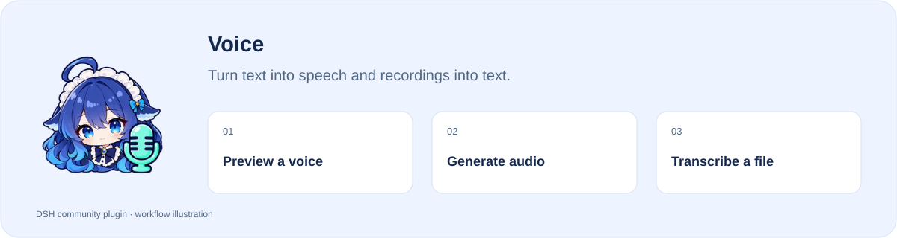

[简体中文](README.md) · **English**

# Voice

**Turn text into natural speech and recordings into clean transcripts.**

Voice plugin for DeepSeek Harness (`>=0.2.2-rc.3`): provides zero-key Edge neural text-to-speech (TTS) with OpenAI/SiliconFlow-compatible fallback engines, direct file synthesis with Markdown cleanup, multi-speaker podcast segments, synchronized `.srt`/`.vtt` subtitle export, interactive browser voice previews, and Groq/OpenAI/SiliconFlow/local Whisper speech-to-text (STT) strictly scoped to your session workspace.

[](https://www.npmjs.com/package/dsh-voice) [](https://www.npmjs.com/package/dsh-voice) [](https://www.npmjs.com/package/dsh-voice)

**[Install](#install) · [Get Started in 3 Steps](#get-started-in-3-steps) · [Full Guide](https://github.com/STARDUSTLC666/dsh-voice/blob/master/docs/USAGE.en.md)**

<picture>
  <source media="(prefers-color-scheme: dark) and (max-width: 640px)" srcset="https://raw.githubusercontent.com/STARDUSTLC666/dsh-voice/master/docs/assets/intro/workflow-en-mobile-dark.svg">
  <source media="(max-width: 640px)" srcset="https://raw.githubusercontent.com/STARDUSTLC666/dsh-voice/master/docs/assets/intro/workflow-en-mobile-light.svg">
  <source media="(prefers-color-scheme: dark)" srcset="https://raw.githubusercontent.com/STARDUSTLC666/dsh-voice/master/docs/assets/intro/workflow-en-dark.svg">
  
</picture>

## Highlights

- **Long-form File Synthesis & Markdown Cleanup**: Pass workspace `.md`/`.txt` files directly via `inputFile`; strips code fences, URLs, and formatting automatically and auto-chunks texts over 5,000 characters (up to 100k chars) on sentence boundaries into one seamless MP3.
- **Multi-Speaker Podcasts & Zero-Cost Subtitles**: Compose multi-host dialogues with `segments` and configurable `pauseMs` silences, and export synchronized `.srt`/`.vtt` subtitles alongside either TTS or STT outputs.
- **Voice Filtering & Interactive Audition Page**: Filter voices by `locale`, `gender`, or `tag` (including flagship Multilingual voices), and audition samples in the auto-generated `voice_previews/index.html` page with playback-speed controls and one-click ID copy.
- **Flexible Engines, Oversize Audio & Proxy Support**: Includes `openai`, `siliconflow`, and `custom` TTS/ASR presets (plus keyless local loopback Whisper), `autoCompress: true` for >25 MB recordings via local `ffmpeg` with zero-copy upload, and `http://`, `https://`, `socks5://`, `socks5h://` proxy support (applied live on save).

## Install

Open **Plugins** in the DSH desktop app and install `dsh-voice`, or use the CLI:

```bash
dsh plugin --profile desktop add dsh-voice
```

For the web profile, replace `desktop` with `web`. Restart DSH once after installing. Requires DSH `>=0.2.2-rc.3`. The plugin bundles the `voice-workflow` skill so your assistant automatically follows best practices for narration, podcasts, subtitles, and transcription.

<a id="start-using-it"></a>
## Get Started in 3 Steps

1. **Read-aloud works out of the box (zero API keys)**: Open a DSH session in your target workspace and ask the assistant to audition voices, narrate long Markdown files, produce two-host podcasts, or export `.srt`/`.vtt` subtitles immediately.
2. **Add an ASR key when you need cloud transcription (loopback Whisper is keyless)**: Open **DSH Settings → Plugins → Voice (`dsh-voice`)**, pick `asrEngine` (`groq`, `openai`, `siliconflow`, or `custom`), and enter `asrApiKey` (masked and applied live without restarting; `DSH_VOICE_ASR_KEY` env var is also supported). A `custom` endpoint on `127.0.0.1`/`localhost` works with no API key.
3. **Preview, synthesize, or transcribe inside your workspace**: Keep input scripts and recordings inside your session workspace; generated MP3s, `.txt` transcripts, `.srt`/`.vtt` subtitles, and preview pages stay safely inside the workspace and auto-number instead of overwriting existing files.

## Copy-Ready Prompts for Everyday Work

- **Filter podcast voices and audition them in a browser page**
  > Filter voices tagged `podcast` and generate short previews with `voice_previews/index.html` so I can listen first, then render the full MP3 once I pick one.
- **Turn a Markdown report into a two-host podcast with subtitles**
  > Read `weekly-report.md` in this workspace and turn it into a two-host dialogue (`zh-CN-XiaoxiaoMultilingualNeural` and `zh-CN-YunyiMultilingualNeural`), saving `podcast.mp3` and `podcast.srt`.
- **Transcribe a large meeting recording with subtitles & action items**
  > Transcribe `meeting.m4a` in this workspace (auto-compress if over 25 MB), save `meeting.txt` and `meeting.srt`, and list the action items.

## Quick Troubleshooting Checklist

| Symptom | Likely Cause | Fix |
| :--- | :--- | :--- |
| Health check says `asrApiKey` is missing, but you only want TTS | ASR key is only needed for audio-to-text transcription | **Keep using TTS directly** — health check reports `ttsReady` / `sttReady` separately and supports `scope: "tts"` |
| "Must stay inside the session workspace" error | Script, recording, or output path points outside the workspace folder | Copy the file into the current DSH workspace folder first |
| Network / connection error | Corporate firewall or proxy required to reach Edge TTS / ASR | Set `proxyUrl` (`http://`, `https://`, `socks5://`, or `socks5h://`) in **DSH Settings → Plugins → Voice** (applies live) |
| Audio exceeds 25 MB limit | Standard Whisper/ASR upload limit is 25 MB | Ask the assistant to enable `autoCompress: true` (uses local `ffmpeg`) or pre-process with `dsh-ffmpeg` |

## Plugin updates

Check updates at the bottom of native plugin details. Automatic checks are on by default; **automatic installation is off**. Suite-managed components update with their bundle.

## Documentation

- [Usage guide and configuration reference](https://github.com/STARDUSTLC666/dsh-voice/blob/master/docs/USAGE.en.md)
- [Full reference](https://github.com/STARDUSTLC666/dsh-voice/blob/master/docs/REFERENCE.en.md)
- [Release notes](https://github.com/STARDUSTLC666/dsh-voice/blob/master/CHANGELOG.md)
- [Validation scope and history](https://github.com/STARDUSTLC666/dsh-voice/blob/master/docs/VALIDATION.md)

## Feedback and contributions

If the plugin helps, a Star makes it easier for others to discover. Report issues in [Issues](https://github.com/STARDUSTLC666/dsh-voice/issues) or open [PRs](https://github.com/STARDUSTLC666/dsh-voice/pulls) (please strip credentials).

## License

[MIT AND LGPL-3.0-only](https://github.com/STARDUSTLC666/dsh-voice/blob/master/LICENSE)

<a id="what-it-does"></a>
<a id="requirements-and-configuration"></a>
