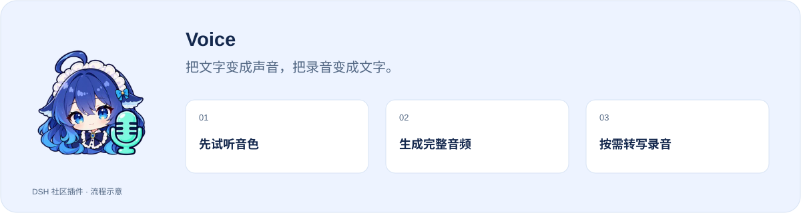

**简体中文** · [English](README.en.md)

# Voice

> **一句话许愿，把文字变成自然人声，把音视频变成干净文字。**

DeepSeek Harness（`>=0.2.2-rc.3`）许愿式聊天优先语音插件，附带 5 主题 **Voice Studio** 侧边栏工作台；零密钥开箱即用 Edge 神经网络语音，严格限制读写在当前会话工作区内。

[](https://www.npmjs.com/package/dsh-voice) [](https://www.npmjs.com/package/dsh-voice) [](https://www.npmjs.com/package/dsh-voice)

**[核心能力](#核心能力) · [安装](#安装) · [最快 3 步用起来](#最快-3-步用起来) · [完整说明](https://github.com/STARDUSTLC666/dsh-voice/blob/master/docs/USAGE.md)**

<picture>
  <source media="(prefers-color-scheme: dark) and (max-width: 640px)" srcset="https://raw.githubusercontent.com/STARDUSTLC666/dsh-voice/master/docs/assets/intro/workflow-zh-mobile-dark.svg">
  <source media="(max-width: 640px)" srcset="https://raw.githubusercontent.com/STARDUSTLC666/dsh-voice/master/docs/assets/intro/workflow-zh-mobile-light.svg">
  <source media="(prefers-color-scheme: dark)" srcset="https://raw.githubusercontent.com/STARDUSTLC666/dsh-voice/master/docs/assets/intro/workflow-zh-dark.svg">
  
</picture>

## 核心能力

| 模块 | 核心特性 |
| :--- | :--- |
| **许愿式场景直出** | 内置 6 大场景配方（播客 / 短视频 / 有声书 / 简报 / 故事 / 配音），支持自然语言风格与方言模糊选声（如“深夜”“纪录片”“粤语男声”）及 `targetDurationSec` 目标时长校准 |
| **交互播放器与记偏好** | 内置词边界安全技术发音词典（`Nginx`/`K8s`/`SQL` 等），一键输出零依赖 `.player.html` 交互跟读播放器；支持对话动口持久化记住个人偏好（`voice_prefs`） |
| **多引擎与声音克隆** | 默认零密钥 Edge TTS（51 内置 + 300+ 在线音色、10 套人设），按需扩展 OpenAI / SiliconFlow / 自定义引擎，支持情绪演技、Kokoro 混音与零样本克隆 |
| **字幕与播客后期** | 支持竖屏卡拉 OK `.ass` 逐词高亮字幕、内联停顿（`[pause:500ms]`）、MP3 ID3v2 原生章节书签、`.srt`/`.vtt` 零漂移反向配音与播客 BGM 自动闪避（`-16 LUFS`） |
| **音视频直传转写** | `voice_stt` 支持 `.mp4`/`.mkv`/`.mov`/`.avi` 自动抽音转写、说话人区分（`diarize`）、超 25MB 自动切片与本机回环免密 Whisper |
| **Voice Studio 工作台** | 按需打开侧边栏进行 8 秒麦克风录音一键建克隆角色、多角色对话编排与成品跟读回放，支持 5 套明亮主题实时切换 |

### 内置 6 个工具速览

| 工具 | 用途 |
| :--- | :--- |
| `voice_tts` | 一体化合成 MP3、同步字幕（`.srt`/`.vtt`/`.ass`）、MP3 章节、`.player.html` 与 BGM 闪避播客 |
| `voice_stt` | 音视频转文字与字幕，支持视频容器自动抽音、说话人区分与超限自动压缩 |
| `voice_list` | 检索 51 个实测内置与 300+ 在线 Edge 音色、10 套人设及自定义角色别名 |
| `voice_preview` | 按场景/风格一键精选 3–4 个音色批量试听并生成 `voice_previews/index.html` 对比页 |
| `voice_health` | 纯本地离线自检，按 `tts` / `stt` / `all` 分别汇报就绪状态 |
| `voice_prefs` | 对话动口持久化保存默认音色、语速音调、发音词典与角色别名（严格隔离密钥） |

## 安装

在 DSH 桌面版「插件」面板安装 `dsh-voice`，或使用命令行：

```bash
dsh plugin --profile desktop add dsh-voice
```

网页版将 `desktop` 改为 `web`，安装后重启 DSH。宿主要求：`>=0.2.2-rc.3`（随包附带 `voice-workflow` 技能包）。

<a id="开始使用"></a>
## 最快 3 步用起来

1. **直接在聊天框许愿（TTS 零密钥）**：装好即对助手说「把 `report.md` 做成带章节和交互播放器的有声书」或「挑几个播客声音试听」，1–2 步交付全套成品。
2. **动口记习惯，按需配克隆/转写**：随时对助手说「以后默认用纪录片声音」即可持久化；需要克隆或 `voice_stt` 时再到 **DSH 设置 → 插件 → 语音** 切换引擎或填写 `asrApiKey`（本机回环免密）。
3. **打开 `.player.html` 或 Voice Studio**：所有文件均安全落在当前工作区（同名自动编号不误盖），可直接浏览器跟读，或打开侧边栏做 8 秒录音克隆与成品管理。

### 常用对话示例

- **按场景试听挑音色**：`帮我挑几个适合科技播客的声音试听一下，生成对比网页让我选。`
- **多标题文档转有声书**：`把工作区里的 weekly-report.md 做成沉稳纪录片风格的有声书，带上章节书签、字幕和 .player.html。`
- **双人播客 + BGM 闪避**：`把这份更新日志改写成双人播客（配 assets/bgm.mp3），做好响度均衡和交互播放器。`
- **30 秒短视频口播 + 花字字幕**：`用有感染力的声音读这段稿（保留 [pause:500ms] 停顿，总时长控制在 30 秒内），导出 clip.mp3 和卡拉 OK clip.ass。`
- **方言配音 + 记住偏好**：`用粤语男声读这段介绍；以后默认用「纪录片」声音、语速 -5%，并把 Cordis 读成科迪斯。`
- **卡点配音 / 视频转写**：`按 video.srt 做零漂移中文配音；或把 lecture.mp4 直接转写成带说话人区分的纪要和 lecture.srt。`

## 常见卡点自检

| 现象 | 原因 | 处理方式 |
| :--- | :--- | :--- |
| 自检提示「缺 ASR 密钥」但只想朗读 | ASR 密钥仅转写（`voice_stt`）需要 | **直接正常合成即可**，可用 `voice_health({ scope: "tts" })` 单独核对 |
| 传入 `referenceAudio` 提示不支持克隆 | 默认 `edge` 引擎不支持零样本克隆 | 在插件设置将 `ttsEngine` 切为 `siliconflow` 或 `custom`（保存即生效） |
| 响度均衡跳过，或视频抽音/BGM 报缺工具 | `-16 LUFS`、抽音、闪避与 `atempo` 依赖本机 `ffmpeg` | 响度均衡会自动优雅降级输出干净 MP3；安装本机 `ffmpeg` 解锁全套后期 |
| 提示「必须位于会话工作区内」 | 输入或输出路径超出了当前工作区 | 先将文件放进当前会话工作区文件夹再操作 |
| 合成或转写报网络连接失败 | 受限网络无法直连在线服务 | 在插件设置填入 `proxyUrl`（支持 `http`/`https`/`socks5`），保存即生效 |
| 音频超过 25MB 无法转写 | 在线 ASR 接口单文件上限 25MB | 开启 `autoCompress: true` 自动抽音切片，或先用 `dsh-ffmpeg` 压缩 |

## 插件更新

在原生插件详情页底部检查更新。默认自动检查，**默认不自动安装**；Suite 管理的组件随整包更新。

## 文档与反馈

- [使用说明与参数参考](https://github.com/STARDUSTLC666/dsh-voice/blob/master/docs/USAGE.md) · [详细参考](https://github.com/STARDUSTLC666/dsh-voice/blob/master/docs/REFERENCE.zh.md) · [更新记录](https://github.com/STARDUSTLC666/dsh-voice/blob/master/CHANGELOG.md) · [验证历史](https://github.com/STARDUSTLC666/dsh-voice/blob/master/docs/VALIDATION.md)
- 欢迎 Star、提交 [Issues](https://github.com/STARDUSTLC666/dsh-voice/issues) 与 [PR](https://github.com/STARDUSTLC666/dsh-voice/pulls)（反馈请移除凭据）。

## License

[MIT AND LGPL-3.0-only](https://github.com/STARDUSTLC666/dsh-voice/blob/master/LICENSE)

<a id="依赖与配置"></a>
