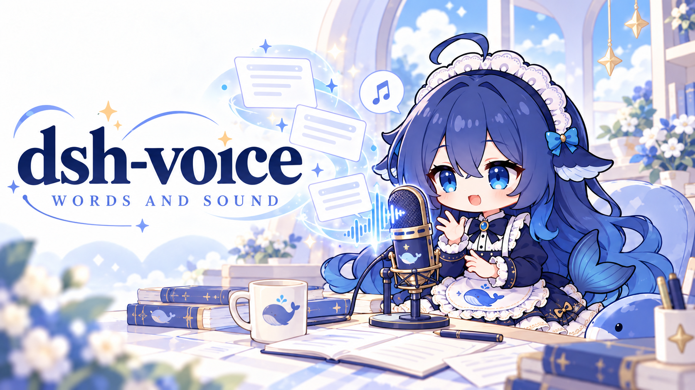

> Full usage reference. The landing page focuses on outcomes, installation and workflows; detailed parameters, limits, update rules and historical validation links remain here.

# dsh-voice

[中文](./REFERENCE.zh.md)



Generate natural speech or transcribe workspace audio and video from DSH (v0.11.0). Ships zero-key Edge neural TTS, OpenAI / SiliconFlow / custom-compatible TTS & ASR, the 5-theme **Voice Studio** sidebar workbench, and the bundled `voice-workflow` skill with strict session-workspace isolation and non-destructive output defaults.

[](https://www.npmjs.com/package/dsh-voice) [](https://www.npmjs.com/package/dsh-voice) [](https://www.npmjs.com/package/dsh-voice)

[Download statistics](https://github.com/STARDUSTLC666/dsh-suite/blob/npm-downloads/README.md)

Feedback and contributions are welcome: report [issues](https://github.com/STARDUSTLC666/dsh-voice/issues) or submit [pull requests](https://github.com/STARDUSTLC666/dsh-voice/pulls).

## What it does

- **Wish-driven scenes & duration fitting**: 6 built-in scene presets (`podcast` / `short-video` / `audiobook` / `briefing` / `story` / `dubbing`), fuzzy style/dialect voice resolution, and automatic `targetDurationSec` duration fitting.
- **Multi-engine TTS & voice cloning**: Zero-key Edge TTS out of the box (51 verified built-in + 300+ online voices, 10 personas), plus OpenAI / SiliconFlow / custom-compatible endpoints with emotion/style `instructions`, Kokoro voice blending, and zero-shot voice cloning (`referenceAudio` / `referenceText`).
- **Interactive player, captions & mastering**: Zero-dependency `.player.html` follow-along player, word-boundary-safe tech pronunciation lexicon (11 built-in + custom `pronunciations`), vertical karaoke `.ass` (`\kf`) and `.srt`/`.vtt` subtitles, inline `[pause:500ms]` beats, native MP3 ID3v2 chapters, zero-drift `.srt`/`.vtt` dubbing, and BGM auto-ducking / `-16 LUFS` loudness normalization.
- **Direct video container transcription**: `voice_stt` accepts `.mp4`/`.mkv`/`.mov`/`.avi` directly with automatic audio extraction, `diarize` speaker separation, `autoCompress` (>25 MB), and keyless loopback Whisper.
- **Conversational preferences (`voice_prefs`) & 6 tools**: Registers `voice_tts`, `voice_stt`, `voice_list`, `voice_preview`, `voice_health`, and `voice_prefs` so users can persist non-credential creative defaults (default voice, rate, pitch, lexicon, custom aliases) directly from chat.
- **5-theme Voice Studio workbench**: Sidebar workbench with 5 bright themes (`harness` / `cream` / `claude` / `pixel8bit` / `mint`), 8-second browser mic one-click clone creation, multi-speaker dialogue authoring, custom alias editing, and Workspace Library click-to-seek playback.

## Install

In DSH Desktop, install `dsh-voice` from the Plugins panel. If the bundled dsh command is available:

```bash
dsh plugin --profile desktop add dsh-voice
```

For the web version, replace `desktop` with `web`. Restart DSH after installation.

## Start using it

1. Start a DSH session in the workspace where you want the audio saved; ask it to check the voice tools.
2. Provide text, language, voice and speed, for example: “Make a Chinese MP3 from this text; give me a short sample first.”
3. Listen to the sample, generate the complete audio, then play or deliver the returned file.
4. For transcription, configure your own compatible ASR service, provide a local audio file, then review the transcript.

## Requirements and configuration

Speech synthesis requires network access. Transcription needs an ASR endpoint and key. A plugin-specific proxy can be configured.

Detailed configuration, tool arguments and troubleshooting are in the [usage guide](USAGE.en.md). For standalone development, follow the Node requirement in [package.json](../package.json).

## Documentation

- [Usage and troubleshooting](USAGE.en.md)
- [Changelog](../CHANGELOG.md)
- [Validation scope and history](VALIDATION.md)
- [Report a problem or suggest a feature](https://github.com/STARDUSTLC666/dsh-voice/issues)

## Plugin updates

Requires DSH 0.2.2-rc.3 or newer. Update controls sit at the bottom of the existing workbench, or native plugin details for plugins without a workbench. Checks, release notes and preferences expand in place, with no separate update page or settings menu. Automatic checks are on by default; **automatic installation is off by default**. Only explicit opt-in permits compatible stable updates (minor and patch by default, with an optional patch-only scope) while idle with no unsaved changes. Preferences are independent, with per-plugin disable, deferral and ignore controls. No forced DSH restart or upgrade, and local-source installations stay unchanged. Suite components explain and operate on the whole Suite in the same footer.

Older releases need one manual update in native plugin management to acquire these controls. Publishing to npm does not replace an existing user installation.

## License

Original code: [MIT](../LICENSE). The separate Edge v2 token module is LGPLv3; its source and license are included. See [third-party notices](../THIRD_PARTY_NOTICES.md).
